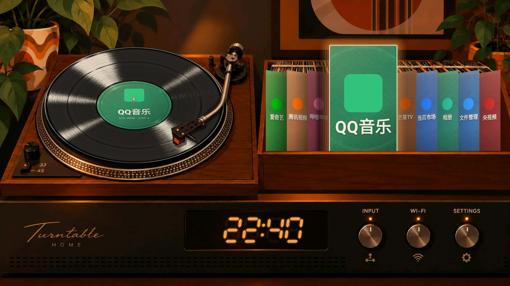
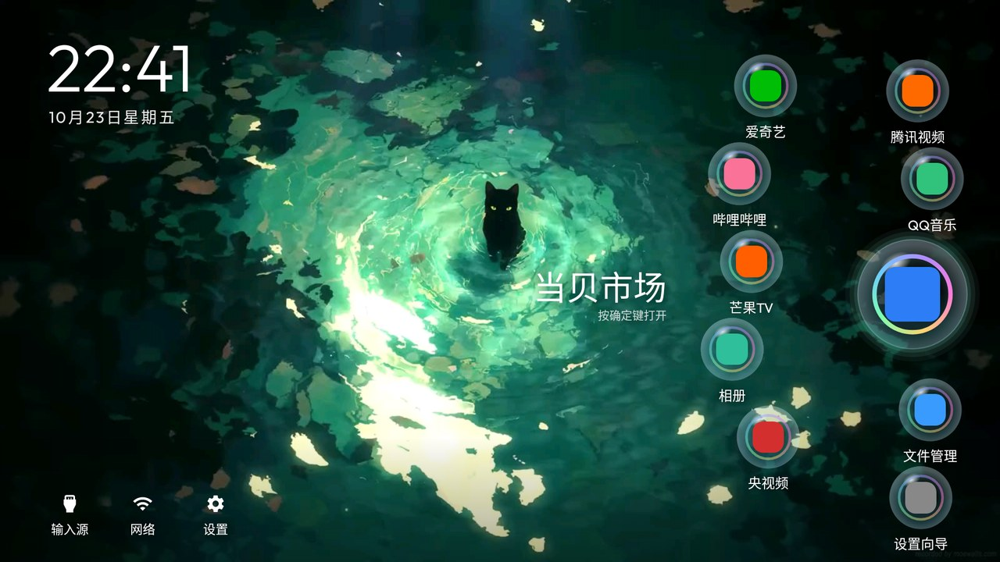

# 使用指南：一条命令装好新桌面，再清理电视广告

这是 [meepwnsoul/cleanyourtv](https://github.com/meepwnsoul/cleanyourtv) 的中文上手说明。它基于开源项目
[Gathin23/cleanyourtv](https://github.com/Gathin23/cleanyourtv)，在原项目基础上新增了：

- **两套新桌面**：唱片机桌面，以及给高配电视用的气泡视频桌面。
- **多桌面切换**：一台电视存好几套桌面，用遥控器随时切换。
- **一键安装**：附带编译好的安装包，不用装 Java 和 Android SDK。
- **TCL 适配**：不允许更换桌面的 TCL 电视也能用。

| 唱片机 | 气泡视频（高配电视） |
|---|---|
|  |  |

截图是在电脑上用示例应用渲染出来的，装到电视上会显示你自己的应用。

所有改动都可以撤销：

- **只停用，不卸载**：广告、统计和预装应用只是被停用，一条命令全部恢复。
- **不需要 root，不刷机**：只用电视自带的开发者选项和 ADB 调试。

## 一、先确认你的电视能不能用

| 电视系统 | 能做什么 |
|---|---|
| Android TV、Google TV（小米、TCL、海信、索尼、雷鸟、创维的大部分型号，以及各种盒子） | 换上新桌面，并清理广告 |
| 部分国行 TCL、雷鸟（例如 TCL ak30a5） | 固件不允许第三方桌面，安装脚本会自动改为装成**普通应用**，原厂桌面保留；广告照样可以清理 |
| 亚马逊 Fire TV | 只能清理广告，换不了桌面 |
| 三星（Tizen）、LG（webOS） | 不支持 |

气泡视频桌面需要大约 2GB 以上内存。内存不够的电视，安装脚本会自动跳过它。

## 二、准备

1. **电脑**：Mac、Linux，或者装了 [Git for Windows](https://git-scm.com/download/win)（自带 Git Bash）的 Windows；装好 Python 3。电脑和电视连在**同一个网络**下。
2. **电视上打开调试**：
   1. 设置 → 设备偏好设置（或"通用"）→ 关于 → 在"版本号"上连按 7 次确定键，开启开发者选项。
   2. 返回 → 开发者选项 → 打开 **USB 调试**；如果有"网络调试"或"ADB 调试"，也打开。
   3. 在网络设置里记下电视的 **IP 地址**，例如 `192.168.1.50`。
   4. 整个过程中保持电视开机。

## 三、一条命令安装桌面

```bash
git clone https://github.com/meepwnsoul/cleanyourtv
cd cleanyourtv
TV_HOST=192.168.1.50 ./install.sh
```

把 `192.168.1.50` 换成你电视的 IP。不会用 git 的话：在仓库首页点绿色的 **Code → Download ZIP**，解压后进入文件夹，再运行最后一行。

电视第一次弹出"允许 USB 调试吗？"时，选**允许**（可以勾选"始终允许"）。脚本会自动完成：

1. 连接电视，检查型号、系统版本和内存。
2. 安装新桌面并设为默认，沿用原项目的安全检查：新桌面确认能启动之后，才会停用原厂桌面。
3. 如果电视拒绝第三方桌面（比如 TCL ak30a5），自动改为装成普通应用，原厂桌面保留。
4. 把唱片机、气泡视频和几套经典主题存到电视上，先显示唱片机桌面。视频较大，这一步要等一两分钟。

可选设置，加在命令前面：

| 设置 | 作用 |
|---|---|
| `DESKTOP=bubbles` | 一开始显示哪个桌面：`turntable`、`bubbles`、`default`、`aurora`、`glass`、`scenes` |
| `DESKTOPS="turntable default"` | 只存这几套桌面 |
| `MODE=app` | 不替换原厂桌面，只装成普通应用 |
| `DEBLOAT=examples/<型号>/debloat.txt` | 顺便清理广告，见第五节 |

例如：`DESKTOP=bubbles TV_HOST=192.168.1.50 ./install.sh`

## 四、用遥控器操作

**切换桌面**：打开 Launcher 设置 → **桌面**，带预览图；或者在设置按钮上**长按确定键** → **切换桌面**。

**唱片机桌面**

- 左右键选应用，唱臂会抬起、换上对应应用的唱片再落下。
- 下键到功放的三个旋钮：信号源、网络、设置。
- 确定键打开；在旋钮上按住确定键，打开桌面菜单（排序、切换桌面）。

**气泡桌面**

- 方向键在气泡之间就近移动，往左下走到信号源、网络、设置。
- 确定键打开应用，气泡会破开再重新鼓起来。
- 应用超过 11 个时，最后一个气泡是"全部应用"。

TCL 这类装成普通应用的电视：从原厂桌面的应用列表里打开 CleanYourTV。

## 五、清理广告

每个品牌、型号的广告和统计应用都不一样，这一步没法对所有电视一键完成。

**如果 [`examples/`](examples/README.md) 里有你的型号**，一条命令就行：

```bash
DEBLOAT=examples/<型号文件夹>/debloat.txt TV_HOST=192.168.1.50 ./install.sh
```

**如果没有**，让 AI 编程助手（[Claude Code](https://claude.com/claude-code)、[Codex CLI](https://github.com/openai/codex) 或 [Gemini CLI](https://github.com/google-gemini/gemini-cli)）在电视上排查。在 `cleanyourtv` 文件夹里启动助手，把下面这段话发给它：

```
我克隆了 cleanyourtv 这个仓库，桌面已经用 install.sh 装好了。请按照仓库里的 PROMPT.md 帮我清理电视的广告、
开机广告和统计上报，复用 tools/ 里现成的工具。我的电视型号是：<型号>，IP 是：<IP>。
先备份；每一步都在真电视上操作并用截图确认；不确定的应用先问我。不要重新安装桌面。
完成后告诉我怎么一键恢复。
```

## 六、不想要了，一键恢复

```bash
TV_HOST=192.168.1.50 tools/restore.sh examples/<你的型号>/debloat.txt
```

被停用的应用全部恢复，原厂桌面回来。装成普通应用的版本，卸载一条命令即可：
`TV_HOST=192.168.1.50 tools/venv/bin/python -I tools/tv.py 'pm uninstall com.gathin.tvhome'`。

## 注意事项

- **真机测试**：新桌面和安装脚本目前只在电脑上编译、测试和渲染过，还没在每种电视上实测。遇到问题，请把脚本的输出发到仓库的 Issues。
- 只在你自己拥有的电视上操作。修改电视软件可能影响保修，风险自负。
- 固件升级后，被停用的应用可能会被重新启用。用 `tools/check.py` 检查一遍，再运行一次清理就行。
- 截图分享到网上之前，记得把 Wi‑Fi 名称和人名打码。
- 设计稿和网页版交互样机在 [`designs/`](designs/README.md)。
- 本仓库沿用原项目的 MIT 许可证，见 [LICENSE](LICENSE)。气泡桌面的视频来源见 [designs/bubble-home/README.md](designs/bubble-home/README.md#视频来源)。
